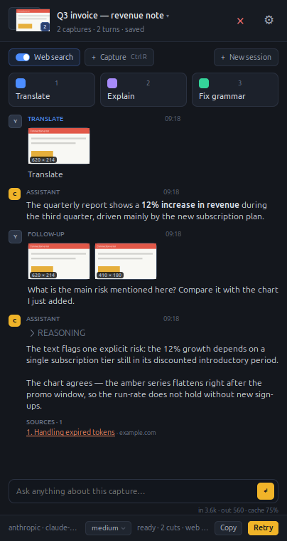
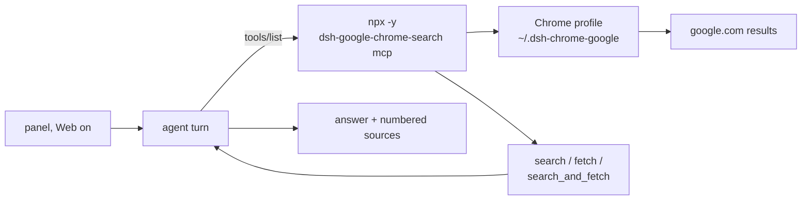

# Chinchilla

Select part of your screen, ask a vision model about it.

Press `Ctrl+Alt+A` (`⌃⌥A` on a Mac), drag a box, and a panel opens with **Translate**,
**Explain**, **Fix grammar** and a free prompt box. Keep the conversation
going, add more screen cuts, switch between saved sessions.



The panel is also a normal chat: ask a plain question without cutting anything.
A cut rides with the next message only, so follow-ups stay text.

Runs on Linux desktops (GNOME/Wayland tested) and on macOS (Apple silicon
tested), no terminal required once installed.

## Status

New here? Jump to [Installation](#installation).

Feature complete through the build order in [`docs/PLAN.md`](docs/PLAN.md).
Design source of truth: [`docs/wireframes/wireframes.html`](docs/wireframes/wireframes.html).
The verification notes are an internal audit and are kept out of the
repository.

## Installation

Chinchilla is a GTK 3 desktop app. GTK, PyGObject and pycairo come from the
system package manager (they cannot be pip-installed); the Python code and its
two libraries live in a virtualenv that can see them.

Steps 1-3 and 6 depend on the platform, the rest is shared:

| Step | Ubuntu (GNOME) | macOS |
| --- | --- | --- |
| 1-3. Requirements, packages, the app | [Ubuntu](#ubuntu-gnome) | [macOS](#macos) |
| 4. Provider keys, GitHub Copilot | [shared](#4-provider-keys) | [shared](#4-provider-keys) |
| 5. Web search (optional) | [shared](#5-web-search) | [shared](#5-web-search) |
| 6. Shortcut and autostart | [GNOME keybinding](#ubuntu-gnome-keybinding-and-autostart) | [login agent and hotkey](#macos-login-agent-and-hotkey) |
| 7-9. Check, troubleshoot, uninstall | [shared](#7-check-the-installation) | [shared](#7-check-the-installation) |

### Ubuntu (GNOME)

Tested on Ubuntu 24.04 with GNOME 46 on Wayland. Other GNOME distributions with
GTK 3 and `xdg-desktop-portal` should work; KDE and plain window managers are
untested.

#### 1. Requirements (Ubuntu)

| Needed for | Version | Debian/Ubuntu package |
| --- | --- | --- |
| Runtime | Python 3.10+ | `python3` |
| The UI | PyGObject + GTK 3 typelibs | `python3-gi`, `gir1.2-gtk-3.0` |
| Silent capture | portal with the GNOME backend | `xdg-desktop-portal`, `xdg-desktop-portal-gnome` |
| The overlay on Wayland | XWayland (the UI runs on `GDK_BACKEND=x11`) | `xwayland` |
| The `Ctrl+Alt+A` binding | `gsettings` and `gsd-media-keys` | `libglib2.0-bin`, `gnome-settings-daemon` |
| Tray icon (optional) | AppIndicator typelib, plus the shell extension | `gir1.2-ayatanaappindicator3-0.1`, `gnome-shell-extension-appindicator` |
| Web search (optional) | Node.js 18+ with `npx` | `nodejs npm`, or [nodejs.org](https://nodejs.org) for a newer one |
| Web search (optional) | Chrome, Chromium, Brave or Edge | `google-chrome-stable`, `chromium-browser`, or `npx dsh-google-chrome-search install-browser` |
| Reading PDFs while searching (optional) | `pdftoppm` | `poppler-utils` |

`python3-gi-cairo` is **not** required. The selector draws into its own cairo
surface and hands the frame to GTK as a pixbuf, so the GTK/cairo bridge is
never needed. Installing it is harmless but changes nothing today.

#### 2. System packages (Ubuntu)

```bash
sudo apt update
sudo apt install -y \
  python3 python3-gi gir1.2-gtk-3.0 \
  xdg-desktop-portal xdg-desktop-portal-gnome xwayland \
  libglib2.0-bin gnome-settings-daemon \
  gir1.2-ayatanaappindicator3-0.1 gnome-shell-extension-appindicator \
  nodejs npm poppler-utils
```

`nodejs npm poppler-utils` are only needed for web search; drop them if you skip
step 5.

Fedora equivalents that matter: `python3-gobject`, `gtk3`,
`xdg-desktop-portal xdg-desktop-portal-gnome`, `xdg-desktop-portal-gtk`,
`glib2`, `libayatana-appindicator-gtk3`.

#### 3. The app (Ubuntu)

```bash
git clone <this repository> chinchilla-auto-translate
cd chinchilla-auto-translate

uv venv --system-site-packages --python /usr/bin/python3
uv pip install -e .                # pillow + httpx
```

Two details matter here:

- `--system-site-packages` is **mandatory**: PyGObject is not on PyPI, so the
  venv has to see the distro's `gi`.
- `--python /usr/bin/python3` is **mandatory too**: without it `uv` may fetch
  its own managed CPython, whose site-packages do not contain the distro
  modules, and `import gi` fails with `ModuleNotFoundError`. Point it at the
  system interpreter that owns `python3-gi`.

Confirmed on a clean environment: that pair of flags gives
`python 3.12.3` + `gtk 3.24.41` inside the venv. `uv` itself, if missing:
`curl -LsSf https://astral.sh/uv/install.sh | sh`.

Use `uv pip install -e .`, not `uv sync`: `uv sync` rebuilds the environment
without `--system-site-packages` and drops `gi` again.

`uv pip install -e .` also creates the `chinchilla` command inside
`.venv/bin/`. Either activate the virtualenv or call it by path:

```bash
source .venv/bin/activate
chinchilla version
```

The virtualenv directory is used by the shortcut (the app stores the absolute
interpreter), so **do not move or recreate it after installing the shortcut** —
re-run `chinchilla shortcuts install` if you do.

Continue with [4. Provider keys](#4-provider-keys).

### macOS

Tested on macOS 27 on Apple silicon with GTK 3.24.52 on the native **Quartz**
backend (from conda-forge, see [no Homebrew bottles](#no-homebrew-bottles-conda-forge-instead);
Homebrew's `gtk+3` is the same Quartz build): no XQuartz, no X11, no D-Bus and
no `pyobjc`.
The few native calls GTK does not cover (global hotkey, Screen Recording grant,
window level, focus) go through `ctypes` to the system frameworks, so the
Python dependencies stay the same two as on Linux. Intel Macs should behave the
same with Homebrew under `/usr/local`.

#### 1. Requirements (macOS)

| Needed for | Version | Where it comes from |
| --- | --- | --- |
| Runtime | Python 3.10+, the one Homebrew's `pygobject3` is built for | `python@3.x`, pulled in by `pygobject3` |
| The UI | GTK 3 (Quartz) + PyGObject + pycairo | `brew install gtk+3 pygobject3` |
| Silent capture | `screencapture` | ships with macOS |
| Seeing other windows in the capture | the **Screen Recording** grant, or ⌘⌃⇧4 without it | System Settings, once (step 3); needs an admin on managed Macs |
| The `⌃⌥A` hotkey | Carbon `RegisterEventHotKey` | ships with macOS, no Accessibility grant needed |
| Menu bar icon | GTK status icon, icon drawn in code | included |
| Web search (optional) | Node.js 18+ with `npx` | `brew install node`, or [nodejs.org](https://nodejs.org) |
| Web search (optional) | Chrome, Chromium, Brave or Edge | the `.app` in `/Applications` (or `~/Applications`), auto-detected |
| Reading PDFs while searching (optional) | `pdftoppm` | `brew install poppler` |

`adwaita-icon-theme` is **not** needed: the only themed icon was the tray icon,
and on macOS it is drawn in code. Skipping it also avoids `librsvg`, which
builds a whole Rust toolchain when no bottle is available.

#### 2. Homebrew packages (macOS)

```bash
brew install gtk+3 pygobject3
brew install node poppler          # only for web search
```

With Homebrew in its default prefix (`/opt/homebrew`) these are bottles and
install in a few minutes.

##### No Homebrew bottles: conda-forge instead

Homebrew bottles only relocate to prefixes of up to 13 characters, so a
Homebrew in a custom prefix (`~/somewhere/homebrew`) builds the whole GTK stack
from source, and at the time of writing `gobject-introspection` fails there
(`undefined local variable or method 'python3'`). conda-forge ships the same
GTK 3 (Quartz) and PyGObject prebuilt, in a self-contained folder:

```bash
# micromamba is a single binary; ~/.local/bin is just a convenient place
mkdir -p ~/.local/bin
curl -fsSL https://micro.mamba.pm/api/micromamba/osx-arm64/latest | tar -xj -C /tmp bin/micromamba
mv /tmp/bin/micromamba ~/.local/bin/

export MAMBA_ROOT_PREFIX=~/micromamba
~/.local/bin/micromamba create -y -n chinchilla -c conda-forge python=3.12 pygobject gtk3 pycairo
PY=~/micromamba/envs/chinchilla/bin/python      # use this as PY in step 3
```

Behind a TLS-inspecting proxy, give micromamba the macOS trust store with
`--ssl-verify <bundle>` (how to build the bundle:
[Corporate networks](#corporate-networks-tls-inspection)). Use `osx-64` instead
of `osx-arm64` on an Intel Mac.

#### 3. The app (macOS)

The venv has to use the exact Python that `pygobject3` was built for (Homebrew
moves it forward over time; `python@3.15` today), otherwise `import gi` fails:

```bash
git clone <this repository> chinchilla-auto-translate
cd chinchilla-auto-translate

# Homebrew: the python@3.x that pygobject3 depends on (conda-forge: PY from above)
PYV=$(brew deps pygobject3 | grep -Eo 'python@3\.[0-9]+' | sort -V | tail -1)
PY="$(brew --prefix "$PYV")/bin/python${PYV#python@}"
"$PY" -c 'import gi, cairo; print("gi", gi.__version__)'   # must print a version

uv venv --system-site-packages --python "$PY"
uv pip install -e .                # pillow + httpx
source .venv/bin/activate
chinchilla version
```

The Ubuntu rules apply unchanged: `--system-site-packages` and an explicit
`--python` are both mandatory, use `uv pip install -e .` and not `uv sync`, and
re-run `chinchilla shortcuts install` after moving or recreating `.venv`. Behind
a TLS-inspecting proxy `uv` reports `invalid peer certificate: UnknownIssuer`;
add `--native-tls` so it trusts the macOS keychain.

**Screen Recording.** macOS answers a capture from an app without this grant
with the wallpaper and the menu bar only: every window is blanked. Ask for it
once:

```bash
chinchilla permission grant      # shows the macOS prompt the first time
chinchilla permission            # granted (Screen Recording)
```

Turn the switch on in **System Settings › Privacy & Security › Screen & System
Audio Recording**, then quit and reopen the app that owns the grant. The grant
belongs to the *responsible* app: your terminal (Terminal, iTerm, VS Code) when
you run `chinchilla` from it, and the **Python** binary (`python3.12`, or
`Python` for Homebrew) when the login agent of step 6 starts it. macOS only
re-reads the grant when that app restarts. Chinchilla asks at most once per
run, so a refused prompt does not come back on every hotkey press.

**No admin rights (managed Macs).** Where only an administrator can add apps to
Screen Recording, every capture Chinchilla starts itself comes back blank,
`screencapture -i` included. macOS's own screenshot tool is not bound by the
grant, so the hotkey switches to a hand-off:

1. `⌃⌥A` opens the panel with `no Screen Recording grant: take the cut with
   ⌘⌃⇧4`.
2. Press **⌘⌃⇧4** (Command+Control+Shift+4, "copy a region to the clipboard")
   and drag the region.
3. Chinchilla sees the new image on the clipboard and attaches it as the cut,
   exactly like its own selector would.
4. For more cuts in the same session just press ⌘⌃⇧4 again: as long as the
   panel is open, every image that lands on the clipboard becomes the next cut
   (copied text is ignored). Hiding the panel stops the watch; `⌃⌥A` starts it
   again.

`chinchilla capture` does the same from a terminal (it waits 90 s for one cut),
and `chinchilla capture --area --backend clipboard` forces it.

**Shorter: plain ⌘⇧4.** If your screenshots are set to go to the clipboard,
plain **⌘⇧4** puts the cut there too, so you can skip Control. To set it,
press ⌘⇧5, then **Options › Save to › Clipboard**, or from a terminal:

```bash
defaults write com.apple.screencapture target clipboard   # "file" restores the Desktop
defaults read com.apple.screencapture target              # clipboard
```

This changes every ⌘⇧3/⌘⇧4 screenshot, not only the ones for Chinchilla: they
stop landing on the Desktop. Without this setting ⌘⇧4 saves a file and
Chinchilla never sees it, which is why the panel hint says ⌘⌃⇧4: that one
copies to the clipboard on every Mac.

**Corporate networks (TLS inspection)**<a id="corporate-networks-tls-inspection"></a>.
A proxy that re-signs TLS breaks `uv`, `micromamba` and the provider calls
(`CERTIFICATE_VERIFY_FAILED ... self-signed certificate in certificate chain`).
Export the macOS keychains (they hold the company root) into a bundle and name
it in `.env`; the app reads `SSL_CERT_FILE` from there, and the login agent
also inherits it from the shell that ran `shortcuts install`:

```bash
security find-certificate -a -p \
  /System/Library/Keychains/SystemRootCertificates.keychain \
  /Library/Keychains/System.keychain \
  ~/Library/Keychains/login.keychain-db > ~/.config/chinchilla/ca-bundle.pem
# if IT ships a separate bundle (often in $NODE_EXTRA_CA_CERTS), append it too
cat "$NODE_EXTRA_CA_CERTS" >> ~/.config/chinchilla/ca-bundle.pem
echo "SSL_CERT_FILE=$HOME/.config/chinchilla/ca-bundle.pem" >> ~/.config/chinchilla/.env
```

`uv` takes `--native-tls` instead.

Continue with [4. Provider keys](#4-provider-keys).

### 4. Provider keys

Pick one provider in the settings dialog (`chinchilla settings`) and give it a
key. Keys are read from the environment, then from `.env`, then from the
credentials file written by the settings dialog. The fifth provider, **GitHub
Copilot**, needs no key at all: it signs in with your subscription (see
[GitHub Copilot](#github-copilot-subscription-login)).

```bash
cp .env.example .env        # or create .env next to pyproject.toml
```

```ini
# provider "openai"
OPENAI_API_KEY=sk-...

# provider "anthropic"
ANTHROPIC_API_KEY=sk-ant-...

# provider "openrouter"
OPENROUTER_API_KEY=sk-or-...

# provider "custom": any OpenAI compatible endpoint
LLM_BASE_URL=https://your-host/v1
LLM_MODEL=your-model
LLM_API_KEY=...
```

`.env` in the project root and `~/.config/chinchilla/.env` are both read; the
real environment wins over both. `.env` is git-ignored — never commit keys.

Rules that are easy to trip over:

- For the `custom` provider, `LLM_BASE_URL` and `LLM_MODEL` from the
  environment or `.env` are the source until you save a different value in the
  settings dialog. The dialog shows the value that is really in use and says
  where it comes from: type another endpoint, press **Save**, and that value
  wins from then on (recorded in `settings.json` as `custom_explicit`). Type the
  environment value back, or clear the field, and `.env` takes over again.
  `chinchilla doctor --verbose` prints the endpoint, the model and which one
  won:

  ```
  endpoint: http://192.168.0.10:1234/v1 (.env (LLM_BASE_URL))
  model:    Qwen3.8_mtp-27B (.env (LLM_MODEL))
  ```

  After saving a value in the dialog the origin reads
  `settings file (saved in the dialog)` and `.env` no longer applies to that
  field.

- `Ctrl+Alt+A` re-activates the same long-lived process, so the app re-reads
  `settings.json`, `.env` and the environment every time the panel opens.
  **No restart, no logout**: edit the file, press the hotkey. The header shows
  the live model and the endpoint behind its tooltip, so you can see which
  server you are actually talking to.

#### GitHub Copilot (subscription login)

The `copilot` provider uses your GitHub Copilot seat instead of an API key, so
there is nothing to paste: the app opens the GitHub device page, you type a
six-character code, and the model list comes from your subscription.

```bash
chinchilla copilot login      # opens the browser, prints the code, waits
chinchilla copilot status      # signed in as ..., api host, token lifetime
chinchilla copilot models      # every chat model your seat can pick
chinchilla copilot-use claude-sonnet-5  # make it the active provider
chinchilla copilot logout      # forget the token
```

The same thing lives in the GUI: **Settings → Providers → GitHub Copilot** has
**Sign in with GitHub**, **Sign out**, **Reload models** and the model dropdown.
Pick a model, press **Save**, and the footer reads `github copilot · Claude
Sonnet 5` (`github copilot · not signed in` before the login).

How it works, and what it writes:

| Piece | Detail |
| --- | --- |
| sign-in | OAuth device flow (`github.com/login/device`, client id of the Copilot editor plugins, scope `read:user`) |
| token | the GitHub token is traded for a short lived Copilot token (`api.github.com/copilot_internal/v2/token`) and refreshed automatically before it expires |
| storage | `~/.config/chinchilla/copilot.json`, mode `0600`; the app never logs it and `chinchilla copilot logout` deletes it |
| endpoint | `https://api.githubcopilot.com`, an OpenAI-compatible `/chat/completions` |
| models | `GET /models`, filtered to the ones served on `/chat/completions` (the GPT-5-and-later and grok models are `/responses` only and would answer every turn with a 400) |

Caveats worth knowing:

- These are the endpoints the official Copilot editor plugins use, **not a
  documented public API**; GitHub can change them and a future release of this
  app may need adjusting. Everything still respects your subscription limits.
- The published `github-copilot-sdk` drives the Copilot CLI runtime over
  JSON-RPC (a downloaded Node runtime plus a process per session). It is not
  used here: this provider streams straight into the panel like the other four,
  with no extra dependency to install on the crew's machines.
- Copilot models reject `temperature` and sometimes `reasoning_effort`; both are
  optional and the request is retried without them, so a model that refuses one
  still answers. When the refusal lists the levels a model does take
  (`gemini-4-hydrogen` stops at `xhigh`), the provider retries with the closest
  lower one instead of losing the reasoning (`claude-haiku-4.5` takes none at
  all, so there it is dropped).

#### Local models (vLLM, llama.cpp, Ollama)

They all serve the OpenAI chat completions API, so use the `custom` provider.
A server on this machine needs **no key**: `localhost`, `127.0.0.1`, `::1`,
`0.0.0.0` and `host.docker.internal` are recognised as local and the
`Authorization` header is simply left out. Any other host still needs a key.

```bash
# a vision model behind vLLM, with tool calling enabled for the Web toggle
vllm serve Qwen/Qwen2.5-VL-7B-Instruct \
  --max-model-len 16384 \
  --enable-auto-tool-choice --tool-call-parser hermes

# point Chinchilla at it (exported, or the same lines in .env)
export LLM_BASE_URL=http://127.0.0.1:8000/v1
export LLM_MODEL=Qwen/Qwen2.5-VL-7B-Instruct
chinchilla doctor                # provider: custom model=... key=not needed by a local server
```

| Server | `LLM_BASE_URL` | `LLM_MODEL` |
| --- | --- | --- |
| vLLM | `http://127.0.0.1:8000/v1` | the `--served-model-name`, or the HF id |
| llama.cpp (`--api-key` not set) | `http://127.0.0.1:8080/v1` | anything, e.g. `local` |
| Ollama | `http://127.0.0.1:11434/v1` | e.g. `qwen2.5vl:7b`, `llava` |

What to expect:

- **Images** are sent as `image_url` data URIs, so the model has to be a VLM.
- **The Web toggle** adds `tools` + `tool_choice: "auto"`. vLLM rejects that
  with `"auto" tool choice requires --enable-auto-tool-choice and
  --tool-call-parser to be set` unless it was started with those flags; keep Web
  off and the request carries no `tools` field at all.
- **Context** is the whole conversation replayed every turn (see
  [Context and token cost](#context-and-token-cost)), so a small
  `--max-model-len` (4096) overflows after a few turns with a cut attached. Use
  16k+ and start a new session for long threads.
- **Thinking models** (R1 distills, QwQ) stream to `reasoning_content`, which
  now shows in the folded `REASONING` block above the answer. llama.cpp and
  vLLM keep the answer in `content`, so nothing is lost.
- **Output budget** is 32768 `max_tokens`; llama.cpp and LM Studio accept it,
  vLLM accepts it up to the model's context, and the request is retried without
  the field if a build complains.
- **Reasoning effort** is sent as `reasoning_effort` on every request (the
  dropdown defaults to `medium`). vLLM only uses it for models started with a
  reasoning parser; a server that answers 400 is retried without the field, so
  an older build still works.
- **Prefix cache** hits are reported by vLLM, so the `cache N%` line under the
  composer works locally too.

### 5. Web search

The agent can look things up while answering. Searches run through
[`dsh-google-chrome-search`](https://github.com/DavidCastilloAlvarado/dsh-google-chrome-search),
an MCP server that drives a real Chrome over CDP and renders the pages it finds.
There is **no search API key** and nothing to configure upstream — it uses a
browser on the machine.

This step is optional: without it everything except the **Web** toggle keeps
working and `chinchilla doctor` reports `websearch: disabled in settings` or
`websearch: /path/npx not installed`.

#### How it fits together



The model gets the server's own tools, and every URL that comes back becomes a
citation under the answer. A single turn may call tools **4 times within 20
seconds**; after that the agent stops and says so instead of crawling.

#### What to install

| Piece | Why | How |
| --- | --- | --- |
| Node.js ≥ 18 with `npx` | runs the MCP server; `npx` downloads it the first time | [nodejs.org](https://nodejs.org); Ubuntu `sudo apt install nodejs npm` (18+); macOS `brew install node` |
| A Chrome-family browser | the server drives it over CDP | Ubuntu: `google-chrome-stable`, `chromium`, Brave or Edge; macOS: Chrome, Chromium, Brave or Edge in `/Applications`; auto-detected |
| `pdftoppm` (optional) | turns a fetched PDF into page images the model can read | Ubuntu `sudo apt install poppler-utils`; macOS `brew install poppler` |

Without any browser on the machine, let the plugin bring its own:

```bash
npx dsh-google-chrome-search install-browser   # ~170 MB, one time
```

It lands in `~/.dsh-chrome-google/browser/` and is found automatically.

Nothing is installed globally and no npm package goes into the project: `npx`
fetches `dsh-google-chrome-search` into `~/.npm/_npx/…` on first use. That first
run downloads the package plus `puppeteer-core`, so expect **20-40 s**; later
searches take 2-5 s.

#### Find `npx` even when it is not on `PATH`

Desktop sessions often start with a shorter `PATH` than your terminal, which is
why `npx: command not found` shows up only inside the app. Chinchilla therefore
probes `PATH` plus `~/.local/node/bin`, `~/.volta/bin`, `~/.bun/bin`,
`~/.nvm/versions/node/*/bin` and `~/.fnm/node-versions/*/installation/bin`
(plus `/opt/homebrew/bin` and `/usr/local/bin` on macOS), and prepends the
directory it found to the server's own `PATH` (the package shebang is
`/usr/bin/env node`). On macOS the login agent also records the `PATH` of the
shell that ran `chinchilla shortcuts install`, so a Node found there is found
by the agent too.

If your Node lives somewhere else, name it explicitly in `.env`:

```ini
WEBSEARCH_MCP_COMMAND=/home/you/opt/node/bin/npx
WEBSEARCH_MCP_ARGS=-y dsh-google-chrome-search mcp
CHROME_PATH=/usr/bin/google-chrome
GSEARCH_PROFILE=/home/you/.dsh-chrome-google
# macOS: CHROME_PATH=/Applications/Google Chrome.app/Contents/MacOS/Google Chrome
```

`WEBSEARCH_MCP_COMMAND` + `WEBSEARCH_MCP_ARGS` replace the whole command, so you
can also point at anything else that speaks MCP over stdio. `CHROME_PATH` and
`GSEARCH_PROFILE` are the two variables the server itself reads; both are also
editable in **Settings → Web**.

#### The Chrome profile

`GSEARCH_PROFILE` defaults to `~/.dsh-chrome-google`, a **separate profile**: the
server never touches your everyday Chrome window, cookies or extensions. Inside
it you will find:

| Path | Content |
| --- | --- |
| `~/.dsh-chrome-google/` | the profile itself (cookies, history of these searches) |
| `~/.dsh-chrome-google/browser/` | a bundled Chrome for Testing, if you ran `install-browser` |
| `~/.dsh-chrome-google/screenshots/` | PDF pages and CAPTCHA screenshots |
| `~/.dsh-chrome-google/downloads/` | PDFs fetched for a turn |

Deleting the folder is safe; it is recreated on the next search, and it is the
usual fix for a wedged profile (`rm -rf ~/.dsh-chrome-google`).

#### Google's CAPTCHA

Google sometimes decides the traffic is automated and shows a verification page.
The server then **opens a visible Chrome window** and waits for a human to solve
it (up to its `verifyTimeoutMs`), and whatever you solved is remembered in the
profile, so later searches pass. Chinchilla never tries to solve it. If nobody
is at the screen, the tool reports the verification requirement instead of
inventing an answer. A Google account login is not needed; `npx
dsh-google-chrome-search login` exists if you prefer a signed-in session.

#### Check it, and switch it on

```bash
chinchilla doctor              # websearch: <command>            (command exists)
chinchilla doctor --verbose    # starts the server, lists its tools
chinchilla search "chinchilla animal" --max 3
```

`chinchilla search` is a one-shot connectivity test: it starts the server, runs a
real search, and prints the sources it got.

```
[1] Chinchilla - Wikipedia <https://en.wikipedia.org/wiki/Chinchilla>
[2] Chinchilla | San Diego Zoo Animals & Plants <https://animals.sandiegozoo.org/animals/chinchilla>
...
```

The same check exists in the UI: **Settings → Web → Check** prints
`ok - tools: search, fetch, search_and_fetch, login, account`.

Two switches gate the feature and both default to on: `mcp_enabled` in the
settings file, and the **Web** toggle in the panel header, which is per session
and saved with it. Turn the panel toggle off for a conversation that should not
search.

### 6. Shortcut and autostart

#### Ubuntu: GNOME keybinding and autostart

```bash
chinchilla shortcuts install     # Ctrl+Alt+A, bound to this virtualenv
chinchilla shortcuts status
chinchilla shortcuts uninstall   # removes it again
```

The binding is a GNOME custom keybinding stored in `gsettings`; it applies
immediately, and `shortcuts install` refreshes it so `gsd-media-keys` picks the
change up. On a non-GNOME desktop add a shortcut by hand pointing at
`.venv/bin/python -m chinchilla capture --panel`.

To keep the tray icon and a warm process after login, add an autostart entry
(run this from the project root, `$(pwd)` fills in the absolute path):

```bash
mkdir -p ~/.config/autostart
cat > ~/.config/autostart/chinchilla.desktop <<EOF
[Desktop Entry]
Type=Application
Name=Chinchilla
Exec=$(pwd)/.venv/bin/python -m chinchilla daemon
X-GNOME-Autostart-enabled=true
NoDisplay=true
EOF
```

#### macOS: login agent and hotkey

macOS has no keybinding daemon that runs a command, so the app owns the hotkey
itself and has to stay running. `shortcuts install` covers both the shortcut
and the autostart:

```bash
chinchilla shortcuts install                              # ⌃⌥A (Control+Option+A)
chinchilla shortcuts install --binding "<Primary><Shift>2"  # or ⌘⇧2, any letter/digit/F-key
chinchilla shortcuts status      # <Control><Alt>a -> .../python -m chinchilla daemon (running, pid 4242)
chinchilla shortcuts uninstall   # stops the agent and removes it
```

What it sets up:

| Piece | Detail |
| --- | --- |
| login agent | `~/Library/LaunchAgents/io.github.chinchilla.plist`, runs `.venv/bin/python -m chinchilla daemon` at login and now; restarted after a crash, left alone after **Quit** |
| hotkey | registered by that process with Carbon `RegisterEventHotKey` (no Accessibility grant); the binding is `hotkey` in `settings.json`, re-read on every activation |
| menu bar | a magnifier icon; click it for **Capture region**, **Sessions**, **Settings**, **Quit**. No Dock icon. After **Quit** the agent stays down until the next login; `chinchilla daemon` from a terminal starts it again |
| single instance | the running process holds a lock next to `~/.local/state/chinchilla/control.sock`; later launches (`chinchilla capture --panel`, `chinchilla app`, a second `daemon`) hand their request over through the socket and exit before drawing anything |
| `PATH` | the agent gets the `PATH` of the shell that ran `install`, plus `/opt/homebrew/bin` and `/usr/local/bin`, so `npx` is found |
| output | `~/.local/state/chinchilla/launchd.log` (the app log stays in `chinchilla.log`) |

Bindings use the GTK accelerator syntax: `<Control>`, `<Alt>`/`<Option>`,
`<Shift>`, and `<Primary>`/`<Super>`/`<Cmd>` for ⌘, followed by a letter, a
digit, `space` or `F1`-`F12`. macOS 15+ refuses combinations made only of
Option or Option+Shift; keep Control or ⌘ in it. Inside the panel every
documented `Ctrl` shortcut also works with ⌘.

The agent's process is a different "responsible app" than your terminal, so
the first capture through the hotkey makes macOS ask for **Python**'s Screen
Recording grant. Allow it, then restart the agent so macOS re-reads it:

```bash
launchctl kickstart -k gui/$(id -u)/io.github.chinchilla
```

### 7. Check the installation

```bash
chinchilla doctor
```

Every line must be `ok`. On Ubuntu:

```
[ok  ] python: 3.12.3
[ok  ] gtk: 3.24.41
[ok  ] session: DISPLAY=:0, WAYLAND_DISPLAY=wayland-0
[ok  ] paths: /home/you/.local/share/chinchilla writable
[ok  ] provider: custom model=... key=env:LLM_API_KEY
[ok  ] capture: portal, portal-area, gnome-shell
[ok  ] websearch: /path/npx -y dsh-google-chrome-search mcp
[ok  ] screenshot: granted (app id '...')
[ok  ] shortcut: <Control><Alt>a -> .../python -m chinchilla capture --panel
```

On macOS:

```
[ok  ] python: 3.12.16
[ok  ] gtk: 3.24.52
[ok  ] session: macOS 27.0.1 (quartz)
[ok  ] paths: /Users/you/.local/share/chinchilla writable
[ok  ] provider: copilot model=claude-sonnet-5.5 (signed in as you)
[ok  ] capture: screencapture, screencapture-area, clipboard
[ok  ] websearch: /path/npx -y dsh-google-chrome-search mcp
[ok  ] screenshot: granted (Screen Recording)
[ok  ] shortcut: <Control><Alt>a -> .../python3 -m chinchilla daemon (running, pid 4242)
```

`--verbose` adds the resolved paths, retries the web search server for real and
lists the tools it exposes:

```
[ok  ] websearch: /path/npx -y dsh-google-chrome-search mcp (tools: search, fetch, search_and_fetch, login, account)
       websearch env: npx in /path
       chrome: /usr/bin/google-chrome
       profile: /home/you/.dsh-chrome-google
```

Then press `Ctrl+Alt+A` (`⌃⌥A` on macOS) and drag a box, and run `chinchilla search "hello"` once
to prove the search path end to end. The log is at
`~/.local/state/chinchilla/chinchilla.log` and every run starts with
`invoked: ...`, which is how you tell "the key never fired" from "the key fired
and the capture failed".

On Ubuntu the first capture grants Chinchilla the portal's `screenshot`
permission for its own app id, so no dialog appears and no shutter sound plays.
`chinchilla permission` shows the state and `chinchilla permission revoke`
takes it back. On macOS only you can grant Screen Recording (see
[3. The app (macOS)](#3-the-app-macos)); `chinchilla permission revoke` opens
the System Settings pane where the switch is. Without the grant the
`screenshot` line reads `fail ... until then cuts come from ⌘⌃⇧4 (clipboard)`:
everything works, the cut just comes from the system screenshot tool.

### 8. Troubleshooting

| Symptom | Cause and fix |
| --- | --- |
| `ModuleNotFoundError: gi` | The venv was made without `--system-site-packages`, or with a uv-managed Python that has no distro modules. Recreate it with `uv venv --system-site-packages --python /usr/bin/python3`, then `uv pip install -e .` and `chinchilla shortcuts install` again. |
| `Ctrl+Alt+A` does nothing, log has no `invoked:` | The binding is not live: `chinchilla shortcuts install`, and check nothing else owns `Ctrl+Alt+A`. |
| `invoked:` appears but the panel never opens | `chinchilla capture --panel` in a terminal to see the error; usually a missing `DISPLAY`/`xwayland`. |
| Panel opens, then "capture failed" | The portal refused. `chinchilla permission` shows the grant; `chinchilla doctor` shows which backends are available. The GNOME area selector remains as a fallback. |
| No tray icon | The AppIndicator extension is off. `gnome-extensions enable ubuntu-appindicators@ubuntu.com` (or `appindicatorsupport@rgcjonas.gmail.com` on upstream GNOME), then log out and in. The shortcut and CLI work regardless. |
| `websearch` is not ok | `npx` not found or Chrome missing. `chinchilla doctor --verbose` starts the server and shows the real error; set `WEBSEARCH_MCP_COMMAND` / `CHROME_PATH` in `.env`. |
| `chinchilla search` fails with `not installed` | `npx` is somewhere Chinchilla does not probe. Put its absolute path in `WEBSEARCH_MCP_COMMAND`. |
| A Chrome window appears while the agent answers | Google served a CAPTCHA. Solve it; the profile remembers it. Nobody at the screen? The tool reports the block instead of guessing. |
| Search hangs on the first use | `npx` is downloading the package. Give it 40 s once, or pre-warm with `chinchilla search "test"`. |
| Search returns nothing or `blocked` | The site refused the browser or the profile is wedged: `rm -rf ~/.dsh-chrome-google` and try again. |
| The **Web** toggle does nothing | `mcp_enabled` is off in `~/.config/chinchilla/settings.json`, or the server has no tools; check **Settings → Web → Check**. |
| Nothing is drawn over the screen | `python3-gi-cairo` missing **and** an old checkout: the current build does not need it. Update the code and `uv pip install -e .` again. |
| Blurry or misplaced overlay | A second monitor with a different scale, or a leftover instance. `pgrep -af "chinchilla capture"`, then `kill <pid>`. |

macOS only:

| Symptom | Cause and fix |
| --- | --- |
| `ModuleNotFoundError: gi` | The venv uses a different Python than the one `pygobject3` was built for. Recreate it with the `PY` from [3. The app (macOS)](#3-the-app-macos), then `uv pip install -e .` and `chinchilla shortcuts install` again. After `brew upgrade` moves `pygobject3` to a newer `python@3.x`, do the same. |
| The capture shows only the wallpaper and the menu bar | Screen Recording is missing for the responsible app (your terminal, or **Python** for the login agent). Allow it in System Settings, then restart that app or `launchctl kickstart -k gui/$(id -u)/io.github.chinchilla`. |
| Granting Screen Recording asks for an administrator | A managed Mac. Cancel it and use the [⌘⌃⇧4 hand-off](#3-the-app-macos): `⌃⌥A`, then ⌘⌃⇧4. |
| The hotkey stopped working after clicking the menu bar icon | **Quit** was chosen; the agent does not restart after a clean quit. `chinchilla daemon` starts it again. |
| `CERTIFICATE_VERIFY_FAILED` on login, models or answers | TLS inspection: build the keychain bundle and set `SSL_CERT_FILE` in `~/.config/chinchilla/.env` ([Corporate networks](#corporate-networks-tls-inspection)). |
| `⌃⌥A` does nothing | `chinchilla shortcuts status` must say `running`. The log says `macOS refused ...` when another app owns the combination: pick another with `chinchilla shortcuts install --binding ...`. `hotkey ... pressed` in the log proves the key fired. |
| Nothing happens after `chinchilla capture --panel` | It handed the request to the running agent (`handed over to the running instance` in the log); the panel opens there. `chinchilla shortcuts status` shows its pid. |
| The agent does not start | Read `~/.local/state/chinchilla/launchd.log`; a moved or recreated `.venv` needs `chinchilla shortcuts install` again. |
| No menu bar icon | The menu bar is full (on a notched display extra icons are hidden behind the notch). The hotkey and CLI work regardless. |
| `uv pip install` fails with `invalid peer certificate` | A TLS-inspecting proxy: add `--native-tls`. |
| `brew install gtk+3 pygobject3` builds from source and fails | Homebrew lives in a custom prefix. Use [conda-forge](#no-homebrew-bottles-conda-forge-instead). |

### 9. Uninstall

Ubuntu:

```bash
chinchilla shortcuts uninstall
rm -f ~/.config/autostart/chinchilla.desktop
rm -rf .venv
rm -rf ~/.config/chinchilla ~/.local/share/chinchilla ~/.local/state/chinchilla
```

macOS:

```bash
chinchilla shortcuts uninstall   # stops the agent, removes ~/Library/LaunchAgents/io.github.chinchilla.plist
rm -rf .venv
rm -rf ~/.config/chinchilla ~/.local/share/chinchilla ~/.local/state/chinchilla
brew uninstall pygobject3 gtk+3  # optional, if nothing else uses them
rm -rf ~/micromamba/envs/chinchilla   # instead, if you used conda-forge
```

Remove **Python** (and your terminal, if you added it only for this) from
System Settings › Privacy & Security › Screen & System Audio Recording.

The `rm -rf ~/.config/...` line also deletes your sessions, captures and saved
keys.

## Use

```bash
chinchilla shortcuts install     # Ctrl+Alt+A -> chinchilla capture --panel
                                 # macOS: ⌃⌥A, login agent running the daemon
                                 # (reinstall after moving the checkout)
chinchilla daemon                # tray / menu bar icon, no capture (use it at login)
chinchilla capture --panel       # capture a region and open the panel
chinchilla settings              # tabs: General, Actions, Providers, Web, Data
chinchilla sessions list         # stored conversations
chinchilla search "query"        # one web search through the MCP server
chinchilla copilot status        # GitHub Copilot subscription sign-in state
chinchilla copilot login         # device flow: shows a code to type on github.com
chinchilla copilot models        # models the subscription offers
chinchilla doctor                # environment, provider, capture and shortcut state
chinchilla doctor --verbose      # plus the resolved paths, servers and tools
```

Inside the panel: `Ctrl+R` adds another cut, `Ctrl+N` starts a session,
`Ctrl+S` opens the session selector, `Ctrl+W` toggles web search, `1`/`2`/`3`
run the quick actions and `Esc` hides (on macOS `⌘` works in place of
`Ctrl`). The footer carries **Stop** (keeps the
text already received), **Copy** (last answer to the clipboard) and **Retry**
(regenerates the last answer in place: the question is reused, so no second
turn is added and no new cut is needed).

Next to the model name the footer has a small **effort** dropdown (`low`,
`medium`, `high`, `xhigh`): whatever you pick there is remembered for the next
start and sent to the model as `reasoning_effort` (see
[Reasoning effort](#reasoning-effort)).

Clicking the session title (`▾`) opens the session selector: every stored
conversation, with its first capture, the last question and a search box. The
**+ New session** chip starts a clean thread; the previous one stays on disk.

### Chatting with and without a cut

The panel is a plain chat as well: type in the box and press `Enter` and the
model answers, no capture needed. A cut is **not** a sticky attachment — it
belongs to the next message only:

- take a cut, then send: the message carries that image (the header shows the
  thumbnail until it is sent, then reads `cut sent`);
- follow-up messages go out as text only, so a conversation about one
  screenshot does not re-send it on every turn;
- take another cut mid-conversation and only *that* one rides along with the
  next message. Captures you take before typing are queued, so two cuts taken
  in a row are sent together.

The three quick actions (**Translate**, **Explain**, **Fix grammar**) are image
tasks: with no fresh cut they just say `take a cut first` in the status line.

The model still *sees* earlier cuts of the session, because the conversation is
replayed on each turn — the last four images are kept and older ones are
replaced by a note, so a long thread does not grow the bill.

### Reasoning and the output budget

A thinking model (`Qwen3`, R1 distills, `gpt-5`-style, Claude with extended
thinking) streams two things: the tokens where it thinks, and then the answer.
Both are shown and neither is cut:

- **The thinking** arrives under a folded `REASONING` row above the answer. It
  opens by itself while the model is thinking, folds as soon as the answer
  starts, and stays one click away (click the row to reopen it). It is stored
  with the turn, so scrolling back or reopening the session shows it again.
  Providers name the stream `reasoning_content` (vLLM, llama.cpp, LM Studio) or
  `reasoning` (OpenRouter and some gateways); both are understood, and any other
  field is ignored so it can never leak into the answer.
- **The budget** is 32768 output tokens (`Settings` → General → *Max output
  tokens*). It used to be 1400, which silently truncated long answers — a poem
  stopped mid-sentence. If a server refuses the value, the request is retried
  once *without* `max_tokens`, so the server's own limit applies; Anthropic
  cannot omit it, so it is lowered to the maximum the model announced.
- **A cut reply says so**: when a server still stops early it reports
  `finish_reason: length` and the panel prints `the model hit its output limit`
  in the status line instead of pretending the answer ended.
- Reasoning is **not replayed** to the provider on later turns, so a long think
  costs nothing after the fact; only the answer goes back into the history. The
  `out` counter under the composer does include the thinking tokens, because
  that is what the provider bills.

### Context and token cost

The conversation is replayed in full on every turn — there is no summarisation
yet, so a session's cost grows with the *square* of its length. What keeps it
honest:

| Control | Behaviour |
| --- | --- |
| image budget | `MAX_IMAGES = 4`; newest cuts keep their pixels, older ones become a text note |
| one cut ≈ | ~700 image tokens at `max_side=1400` (measured on a 1400x800 JPEG) |
| prefix caching | automatic with OpenAI-compatible providers, because the history is append-only; Anthropic needs explicit `cache_control`, which is not sent yet |
| reasoning | streamed in its own folded block and never replayed to the model; `out` still bills it |
| accounting | the reply's `usage` is stored per turn and totalled under the composer |

Under the input box the panel prints `in 12.4k · out 1.8k · cache 82%` for the
session: input tokens (cached ones included), output tokens, and the share of
the input the provider served from its cache. Hover it for the exact integers.
`0%` is normal for short conversations — OpenAI-compatible servers only cache a
prompt prefix of about 1024 tokens, so a hit usually shows up after a few turns
or once a cut is in the history.

### Reasoning effort

Some models (`gpt-5`-style, `Qwen3`, R1 distills) accept a `reasoning_effort`
field that trades latency for thinking. The dropdown in the footer picks it:

| Level | Sent as | When it makes sense |
| --- | --- | --- |
| `low` | `"reasoning_effort": "low"` | translations and grammar fixes, where speed matters |
| `medium` | `"reasoning_effort": "medium"` | the default, a balanced answer |
| `high` | `"reasoning_effort": "high"` | explaining a diagram or a stack trace |
| `xhigh` | `"reasoning_effort": "xhigh"` | hard debugging, at the cost of a slow reply |

- The choice is stored in `settings.json`, so it survives a restart;
  `medium` is used until you pick something else. The General settings page has
  the same dropdown, and `chinchilla doctor --verbose` prints both the effort and
  the output budget (`budget: 32768 output tokens`).
- It only applies to the next turn you send: providers are rebuilt per turn, so
  the change needs no restart.
- Only OpenAI-compatible endpoints receive the field (OpenAI, OpenRouter,
  custom/vLLM, and Anthropic is left untouched because its API has no such
  parameter). A server that rejects it with a 400 is retried once without it,
  so an older vLLM or llama.cpp build still answers.
- A reasoning model can spend its whole `max_tokens` budget thinking and return
  empty `content`; Chinchilla then shows a short note instead of a blank answer.
  Lower the effort or use a model that answers directly.

### The capture flow

1. `Ctrl+Alt+A` hides the panel and takes a silent full-screen frame through
   the XDG portal (`xdg-desktop-portal` asks for the *screenshot* permission
   once; Chinchilla records the grant itself, see below). On macOS `⌃⌥A`
   takes it with `screencapture -x -m` (the main display, no shutter sound).
2. Chinchilla's own selector opens over that frozen frame: everything outside
   the drag is dimmed, the selection stays bright, with a border, round grips
   on the corners and edge midpoints, a size badge and a loupe.
   `Enter` confirms, `Esc` cancels, the arrow keys nudge (`Shift` = 10 px).
3. The region is cropped, added to the session and the panel comes back.

No desktop selector and no shutter sound are involved. If the portal refuses
the silent grab (no permission store, another desktop), Chinchilla falls back
to the desktop's own area picker and says so in the panel status; on macOS the
fallback is `screencapture -i`, the system's own crosshair, and without the
Screen Recording grant the cut comes from your own ⌘⌃⇧4 through the clipboard.
Cancelling a selector (`Esc`) ends the capture; no other backend is tried.

#### The screenshot permission

GNOME only answers a non-interactive screenshot for an app id that already owns
the `screenshot` permission, and it derives that id from the systemd scope the
process runs in. `chinchilla permission` shows the state, and the app grants
itself once (for its own id only) so the hotkey never opens a dialog:

```bash
chinchilla permission            # granted (app id 'com.example.Terminal')
chinchilla permission revoke     # ask the desktop again on the next capture
```

macOS has no such store for apps to write: the user grants **Screen Recording**
in System Settings, `chinchilla permission grant` shows the system prompt the
first time, and `chinchilla permission` reads the state with
`CGPreflightScreenCaptureAccess` (see [3. The app (macOS)](#3-the-app-macos)).

### Web search

Turn the **Web** toggle on in the panel header and the agent can call the
server's own tools:

| Tool | Does |
| --- | --- |
| `search` | Google results, plus Google's AI Overview and its references when present |
| `fetch` | renders one URL and extracts its readable content (8000 chars by default) |
| `search_and_fetch` | search, then read the top N pages in one call |
| `login` / `account` | optional Google sign-in, kept in the search profile |

A turn may make **6 tool calls within 150 seconds** (a single call gets 60
seconds), and when the budget runs out the agent still answers: it gets one last
tool-less round with everything it has already read, so a long search never ends
in an empty bubble. Sources come back as a numbered list under the answer —
click a source to open it in your browser, or select its text — and the reply
cites them as `[1]`, `[2]`. Result pages, stylesheets and scraped CSS are
filtered out, so the list only holds pages you can open. The **Web** toggle is
stored per session, so a conversation can be kept offline while others search.

Setup, the profile layout and the CAPTCHA behaviour are in
[Installation step 5](#5-web-search).

### Where things live

| What | Path |
| --- | --- |
| Settings | `~/.config/chinchilla/settings.json` |
| API keys saved from the UI | `~/.config/chinchilla/credentials.json` (mode 0600) |
| Sessions | `~/.local/share/chinchilla/sessions/<id>.json` |
| Captures | `~/.local/share/chinchilla/captures/<id>.jpg` |
| Log | `~/.local/state/chinchilla/chinchilla.log` |
| Web search Chrome profile | `~/.dsh-chrome-google/` (`settings`, `browser/`, `screenshots/`, `downloads/`) |
| npm cache for the MCP server | `~/.npm/_npx/` |
| macOS login agent | `~/Library/LaunchAgents/io.github.chinchilla.plist`, its output in `~/.local/state/chinchilla/launchd.log` |
| macOS single-instance socket | `~/.local/state/chinchilla/control.sock` and its `control.sock.lock` (both mode 0600) |

macOS uses the same XDG-style folders as Linux (`XDG_CONFIG_HOME` and friends
are honoured), so the table holds on both platforms.

## Desktop notes

- The UI runs on GTK 3. On Wayland it forces `GDK_BACKEND=x11` through
  XWayland so the overlay can be a fullscreen, always-on-top window it can
  position itself; plain Wayland toplevels cannot do that.
- Screen capture walks a backend chain (see [`docs/CAPTURE.md`](docs/CAPTURE.md)).
  The silent screenshot needs the portal permission; Chinchilla grants it for
  its own app id and `chinchilla permission revoke` takes it back.
- GTK here has no cairo paint context (`python3-gi-cairo` is not installed on
  every host), so the selector draws each frame into a cairo image surface and
  hands it to a `Gtk.Image` as a pixbuf. The live frame is drawn with red and
  blue swapped because cairo stores pixels as BGRA while the pixbuf reads RGBA;
  `render_to_png` turns the swap off.
- GNOME 46 ignores `Gtk.StatusIcon` unless an extension is installed, so the
  tray falls back to an AppIndicator when one is available; without either the
  shortcut and the CLI keep working.
- The palette used by the overlay, the panel and the settings dialog is in
  `chinchilla/ui/theme.py`.

macOS:

- Homebrew's GTK only has the Quartz backend, so `GDK_BACKEND` is never forced
  there, even when XQuartz left a `DISPLAY` behind.
- `fullscreen()` on Quartz slides the window into a new Space, so the selector
  is instead a borderless window the size of the main display, lifted to the
  screen-saver level (above the menu bar and the Dock) and joined to every
  Space. The frame is in pixels and the selection in points, so a Retina crop
  keeps the full resolution.
- GTK raises its windows but never activates the process, so the panel and the
  selector call `activateIgnoringOtherApps:` to take the keyboard; hiding the
  panel hands the focus back to the app you were in. The process runs with the
  *accessory* activation policy: menu bar icon, no Dock icon.
- `GApplication` is unique through the session D-Bus, which macOS does not
  have; a Unix socket in the state folder keeps one process instead.
- Native calls (`chinchilla/macos/`) use `ctypes` against AppKit, Carbon and
  CoreGraphics, so there is no `pyobjc` to install.

## Development

```bash
uv venv --system-site-packages --python /usr/bin/python3   # macOS: --python "$PY", see step 3
uv pip install -e .
.venv/bin/python -m chinchilla version
.venv/bin/python -m chinchilla doctor
.venv/bin/python -m pytest
```

UI changes are checked by rendering the real widgets to PNG:

```bash
.venv/bin/python -m chinchilla panel --render /tmp/panel.png
.venv/bin/python -m chinchilla settings --render /tmp/settings.png --page 1
.venv/bin/python -m chinchilla sessions list --render /tmp/sessions.png --demo
.venv/bin/python -m chinchilla overlay --render /tmp/overlay.png --select 120,90,320,200
```

Headless capture can be exercised with an image file instead of the screen:

```bash
CHINCHILLA_CAPTURE_SOURCE=/path/to/image.png .venv/bin/python -m chinchilla capture --out /tmp/cut.jpg
```