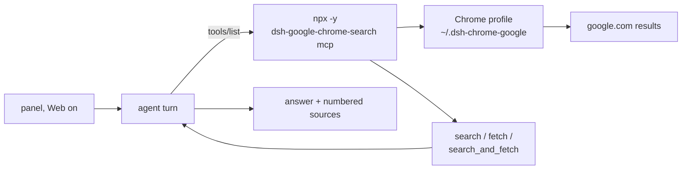

# Chinchilla

Select part of your screen, ask a vision model about it.

Press `Ctrl+Alt+A`, drag a box, and a panel opens with **Translate**,
**Explain**, **Fix grammar** and a free prompt box. Keep the conversation
going, add more screen cuts, switch between saved sessions.

The panel is also a normal chat: ask a plain question without cutting anything.
A cut rides with the next message only, so follow-ups stay text.

Built for Linux desktops (GNOME/Wayland tested), no terminal required.

## Status

New here? Jump to [Installation](#installation).

Feature complete through the build order in [`docs/PLAN.md`](docs/PLAN.md).
Design source of truth: [`docs/wireframes/wireframes.html`](docs/wireframes/wireframes.html).

## Installation

Chinchilla is a GTK 3 desktop app. GTK, PyGObject and the screenshot portal
must come from the system (they cannot be pip-installed); the Python code and
its two libraries live in a virtualenv.

Tested on Ubuntu 24.04 with GNOME 46 on Wayland. Other GNOME distributions with
GTK 3 and `xdg-desktop-portal` should work; KDE and plain window managers are
untested.

### 1. Requirements

| Needed for | Version | Debian/Ubuntu package |
| --- | --- | --- |
| Runtime | Python 3.10+ | `python3` |
| The UI | PyGObject + GTK 3 typelibs | `python3-gi`, `gir1.2-gtk-3.0` |
| Silent capture | portal with the GNOME backend | `xdg-desktop-portal`, `xdg-desktop-portal-gnome` |
| The overlay on Wayland | XWayland (the UI runs on `GDK_BACKEND=x11`) | `xwayland` |
| The `Ctrl+Alt+A` binding | `gsettings` and `gsd-media-keys` | `libglib2.0-bin`, `gnome-settings-daemon` |
| Tray icon (optional) | AppIndicator typelib, plus the shell extension | `gir1.2-ayatanaappindicator3-0.1`, `gnome-shell-extension-appindicator` |
| Web search (optional) | Node.js 18+ with `npx` | `nodejs npm`, or [nodejs.org](https://nodejs.org) for a newer one |
| Web search (optional) | Chrome, Chromium, Brave or Edge | `google-chrome-stable`, `chromium-browser`, or `npx dsh-google-chrome-search install-browser` |
| Reading PDFs while searching (optional) | `pdftoppm` | `poppler-utils` |

`python3-gi-cairo` is **not** required. The selector draws into its own cairo
surface and hands the frame to GTK as a pixbuf, so the GTK/cairo bridge is
never needed. Installing it is harmless but changes nothing today.

### 2. System packages

```bash
sudo apt update
sudo apt install -y \
  python3 python3-gi gir1.2-gtk-3.0 \
  xdg-desktop-portal xdg-desktop-portal-gnome xwayland \
  libglib2.0-bin gnome-settings-daemon \
  gir1.2-ayatanaappindicator3-0.1 gnome-shell-extension-appindicator \
  nodejs npm poppler-utils
```

`nodejs npm poppler-utils` are only needed for web search; drop them if you skip
step 5.

Fedora equivalents that matter: `python3-gobject`, `gtk3`,
`xdg-desktop-portal xdg-desktop-portal-gnome`, `xdg-desktop-portal-gtk`,
`glib2`, `libayatana-appindicator-gtk3`.

### 3. The app

```bash
git clone <this repository> chinchilla-auto-translate
cd chinchilla-auto-translate

uv venv --system-site-packages --python /usr/bin/python3
uv pip install -e .                # pillow + httpx
```

Two details matter here:

- `--system-site-packages` is **mandatory**: PyGObject is not on PyPI, so the
  venv has to see the distro's `gi`.
- `--python /usr/bin/python3` is **mandatory too**: without it `uv` may fetch
  its own managed CPython, whose site-packages do not contain the distro
  modules, and `import gi` fails with `ModuleNotFoundError`. Point it at the
  system interpreter that owns `python3-gi`.

Confirmed on a clean environment: that pair of flags gives
`python 3.12.3` + `gtk 3.24.41` inside the venv. `uv` itself, if missing:
`curl -LsSf https://astral.sh/uv/install.sh | sh`.

Use `uv pip install -e .`, not `uv sync`: `uv sync` rebuilds the environment
without `--system-site-packages` and drops `gi` again.

`uv pip install -e .` also creates the `chinchilla` command inside
`.venv/bin/`. Either activate the virtualenv or call it by path:

```bash
source .venv/bin/activate
chinchilla version
```

The virtualenv directory is used by the shortcut (the app stores the absolute
interpreter), so **do not move or recreate it after installing the shortcut** —
re-run `chinchilla shortcuts install` if you do.

### 4. Provider keys

Pick one provider in the settings dialog (`chinchilla settings`) and give it a
key. Keys are read from the environment, then from `.env`, then from the
credentials file written by the settings dialog.

```bash
cp .env.example .env        # or create .env next to pyproject.toml
```

```ini
# provider "openai"
OPENAI_API_KEY=sk-...

# provider "anthropic"
ANTHROPIC_API_KEY=sk-ant-...

# provider "openrouter"
OPENROUTER_API_KEY=sk-or-...

# provider "custom": any OpenAI compatible endpoint
LLM_BASE_URL=https://your-host/v1
LLM_MODEL=your-model
LLM_API_KEY=...
```

`.env` in the project root and `~/.config/chinchilla/.env` are both read; the
real environment wins over both. `.env` is git-ignored — never commit keys.

Rules that are easy to trip over:

- For the `custom` provider, `LLM_BASE_URL` and `LLM_MODEL` from the
  environment or `.env` are the source until you save a different value in the
  settings dialog. The dialog shows the value that is really in use and says
  where it comes from: type another endpoint, press **Save**, and that value
  wins from then on (recorded in `settings.json` as `custom_explicit`). Type the
  environment value back, or clear the field, and `.env` takes over again.
  `chinchilla doctor --verbose` prints the endpoint, the model and which one
  won:

  ```
  endpoint: http://192.168.0.10:1234/v1 (.env (LLM_BASE_URL))
  model:    Qwen3.8_mtp-27B (.env (LLM_MODEL))
  ```

  After saving a value in the dialog the origin reads
  `settings file (saved in the dialog)` and `.env` no longer applies to that
  field.

- `Ctrl+Alt+A` re-activates the same long-lived process, so the app re-reads
  `settings.json`, `.env` and the environment every time the panel opens.
  **No restart, no logout**: edit the file, press the hotkey. The header shows
  the live model and the endpoint behind its tooltip, so you can see which
  server you are actually talking to.

#### Local models (vLLM, llama.cpp, Ollama)

They all serve the OpenAI chat completions API, so use the `custom` provider.
A server on this machine needs **no key**: `localhost`, `127.0.0.1`, `::1`,
`0.0.0.0` and `host.docker.internal` are recognised as local and the
`Authorization` header is simply left out. Any other host still needs a key.

```bash
# a vision model behind vLLM, with tool calling enabled for the Web toggle
vllm serve Qwen/Qwen2.5-VL-7B-Instruct \
  --max-model-len 16384 \
  --enable-auto-tool-choice --tool-call-parser hermes

# point Chinchilla at it (exported, or the same lines in .env)
export LLM_BASE_URL=http://127.0.0.1:8000/v1
export LLM_MODEL=Qwen/Qwen2.5-VL-7B-Instruct
chinchilla doctor                # provider: custom model=... key=not needed by a local server
```

| Server | `LLM_BASE_URL` | `LLM_MODEL` |
| --- | --- | --- |
| vLLM | `http://127.0.0.1:8000/v1` | the `--served-model-name`, or the HF id |
| llama.cpp (`--api-key` not set) | `http://127.0.0.1:8080/v1` | anything, e.g. `local` |
| Ollama | `http://127.0.0.1:11434/v1` | e.g. `qwen2.5vl:7b`, `llava` |

What to expect:

- **Images** are sent as `image_url` data URIs, so the model has to be a VLM.
- **The Web toggle** adds `tools` + `tool_choice: "auto"`. vLLM rejects that
  with `"auto" tool choice requires --enable-auto-tool-choice and
  --tool-call-parser to be set` unless it was started with those flags; keep Web
  off and the request carries no `tools` field at all.
- **Context** is the whole conversation replayed every turn (see
  [Context and token cost](#context-and-token-cost)), so a small
  `--max-model-len` (4096) overflows after a few turns with a cut attached. Use
  16k+ and start a new session for long threads.
- **Thinking models** (R1 distills, QwQ) stream to `reasoning_content`, which
  the panel does not render yet: the reply appears once the model stops
  thinking.
- **Prefix cache** hits are reported by vLLM, so the `cache N%` line under the
  composer works locally too.

### 5. Web search

The agent can look things up while answering. Searches run through
[`dsh-google-chrome-search`](https://github.com/DavidCastilloAlvarado/dsh-google-chrome-search),
an MCP server that drives a real Chrome over CDP and renders the pages it finds.
There is **no search API key** and nothing to configure upstream — it uses a
browser on the machine.

This step is optional: without it everything except the **Web** toggle keeps
working and `chinchilla doctor` reports `websearch: disabled in settings` or
`websearch: /path/npx not installed`.

#### How it fits together



The model gets the server's own tools, and every URL that comes back becomes a
citation under the answer. A single turn may call tools **4 times within 20
seconds**; after that the agent stops and says so instead of crawling.

#### What to install

| Piece | Why | How |
| --- | --- | --- |
| Node.js ≥ 18 with `npx` | runs the MCP server; `npx` downloads it the first time | [nodejs.org](https://nodejs.org), or `sudo apt install nodejs npm` (Ubuntu's is 18+) |
| A Chrome-family browser | the server drives it over CDP | `google-chrome-stable`, `chromium`, Brave or Edge; auto-detected |
| `poppler-utils` (optional) | turns a fetched PDF into page images the model can read | `sudo apt install poppler-utils` |

Without any browser on the machine, let the plugin bring its own:

```bash
npx dsh-google-chrome-search install-browser   # ~170 MB, one time
```

It lands in `~/.dsh-chrome-google/browser/` and is found automatically.

Nothing is installed globally and no npm package goes into the project: `npx`
fetches `dsh-google-chrome-search` into `~/.npm/_npx/…` on first use. That first
run downloads the package plus `puppeteer-core`, so expect **20-40 s**; later
searches take 2-5 s.

#### Find `npx` even when it is not on `PATH`

Desktop sessions often start with a shorter `PATH` than your terminal, which is
why `npx: command not found` shows up only inside the app. Chinchilla therefore
probes `PATH` plus `~/.local/node/bin`, `~/.volta/bin`, `~/.bun/bin`,
`~/.nvm/versions/node/*/bin` and `~/.fnm/node-versions/*/installation/bin`, and
prepends the directory it found to the server's own `PATH` (the package shebang
is `/usr/bin/env node`).

If your Node lives somewhere else, name it explicitly in `.env`:

```ini
WEBSEARCH_MCP_COMMAND=/home/you/opt/node/bin/npx
WEBSEARCH_MCP_ARGS=-y dsh-google-chrome-search mcp
CHROME_PATH=/usr/bin/google-chrome
GSEARCH_PROFILE=/home/you/.dsh-chrome-google
```

`WEBSEARCH_MCP_COMMAND` + `WEBSEARCH_MCP_ARGS` replace the whole command, so you
can also point at anything else that speaks MCP over stdio. `CHROME_PATH` and
`GSEARCH_PROFILE` are the two variables the server itself reads; both are also
editable in **Settings → Web**.

#### The Chrome profile

`GSEARCH_PROFILE` defaults to `~/.dsh-chrome-google`, a **separate profile**: the
server never touches your everyday Chrome window, cookies or extensions. Inside
it you will find:

| Path | Content |
| --- | --- |
| `~/.dsh-chrome-google/` | the profile itself (cookies, history of these searches) |
| `~/.dsh-chrome-google/browser/` | a bundled Chrome for Testing, if you ran `install-browser` |
| `~/.dsh-chrome-google/screenshots/` | PDF pages and CAPTCHA screenshots |
| `~/.dsh-chrome-google/downloads/` | PDFs fetched for a turn |

Deleting the folder is safe; it is recreated on the next search, and it is the
usual fix for a wedged profile (`rm -rf ~/.dsh-chrome-google`).

#### Google's CAPTCHA

Google sometimes decides the traffic is automated and shows a verification page.
The server then **opens a visible Chrome window** and waits for a human to solve
it (up to its `verifyTimeoutMs`), and whatever you solved is remembered in the
profile, so later searches pass. Chinchilla never tries to solve it. If nobody
is at the screen, the tool reports the verification requirement instead of
inventing an answer. A Google account login is not needed; `npx
dsh-google-chrome-search login` exists if you prefer a signed-in session.

#### Check it, and switch it on

```bash
chinchilla doctor              # websearch: <command>            (command exists)
chinchilla doctor --verbose    # starts the server, lists its tools
chinchilla search "chinchilla animal" --max 3
```

`chinchilla search` is a one-shot connectivity test: it starts the server, runs a
real search, and prints the sources it got.

```
[1] Chinchilla - Wikipedia <https://en.wikipedia.org/wiki/Chinchilla>
[2] Chinchilla | San Diego Zoo Animals & Plants <https://animals.sandiegozoo.org/animals/chinchilla>
...
```

The same check exists in the UI: **Settings → Web → Check** prints
`ok - tools: search, fetch, search_and_fetch, login, account`.

Two switches gate the feature and both default to on: `mcp_enabled` in the
settings file, and the **Web** toggle in the panel header, which is per session
and saved with it. Turn the panel toggle off for a conversation that should not
search.

### 6. Shortcut and autostart

```bash
chinchilla shortcuts install     # Ctrl+Alt+A, bound to this virtualenv
chinchilla shortcuts status
chinchilla shortcuts uninstall   # removes it again
```

The binding is a GNOME custom keybinding stored in `gsettings`; it applies
immediately, and `shortcuts install` refreshes it so `gsd-media-keys` picks the
change up. On a non-GNOME desktop add a shortcut by hand pointing at
`.venv/bin/python -m chinchilla capture --panel`.

To keep the tray icon and a warm process after login, add an autostart entry
(run this from the project root, `$(pwd)` fills in the absolute path):

```bash
mkdir -p ~/.config/autostart
cat > ~/.config/autostart/chinchilla.desktop <<EOF
[Desktop Entry]
Type=Application
Name=Chinchilla
Exec=$(pwd)/.venv/bin/python -m chinchilla daemon
X-GNOME-Autostart-enabled=true
NoDisplay=true
EOF
```

### 7. Check the installation

```bash
chinchilla doctor
```

Every line must be `ok`:

```
[ok  ] python: 3.12.3
[ok  ] gtk: 3.24.41
[ok  ] session: DISPLAY=:0, WAYLAND_DISPLAY=wayland-0
[ok  ] paths: /home/you/.local/share/chinchilla writable
[ok  ] provider: custom model=... key=env:LLM_API_KEY
[ok  ] capture: portal, portal-area, gnome-shell
[ok  ] websearch: /path/npx -y dsh-google-chrome-search mcp
[ok  ] screenshot: granted (app id '...')
[ok  ] shortcut: <Control><Alt>a -> .../python -m chinchilla capture --panel
```

`--verbose` adds the resolved paths, retries the web search server for real and
lists the tools it exposes:

```
[ok  ] websearch: /path/npx -y dsh-google-chrome-search mcp (tools: search, fetch, search_and_fetch, login, account)
       websearch env: npx in /path
       chrome: /usr/bin/google-chrome
       profile: /home/you/.dsh-chrome-google
```

Then press `Ctrl+Alt+A` and drag a box, and run `chinchilla search "hello"` once
to prove the search path end to end. The log is at
`~/.local/state/chinchilla/chinchilla.log` and every run starts with
`invoked: ...`, which is how you tell "the key never fired" from "the key fired
and the capture failed".

The first capture grants Chinchilla the portal's `screenshot` permission for
its own app id, so no dialog appears and no shutter sound plays.
`chinchilla permission` shows the state and `chinchilla permission revoke`
takes it back.

### 8. Troubleshooting

| Symptom | Cause and fix |
| --- | --- |
| `ModuleNotFoundError: gi` | The venv was made without `--system-site-packages`, or with a uv-managed Python that has no distro modules. Recreate it with `uv venv --system-site-packages --python /usr/bin/python3`, then `uv pip install -e .` and `chinchilla shortcuts install` again. |
| `Ctrl+Alt+A` does nothing, log has no `invoked:` | The binding is not live: `chinchilla shortcuts install`, and check nothing else owns `Ctrl+Alt+A`. |
| `invoked:` appears but the panel never opens | `chinchilla capture --panel` in a terminal to see the error; usually a missing `DISPLAY`/`xwayland`. |
| Panel opens, then "capture failed" | The portal refused. `chinchilla permission` shows the grant; `chinchilla doctor` shows which backends are available. The GNOME area selector remains as a fallback. |
| No tray icon | The AppIndicator extension is off. `gnome-extensions enable ubuntu-appindicators@ubuntu.com` (or `appindicatorsupport@rgcjonas.gmail.com` on upstream GNOME), then log out and in. The shortcut and CLI work regardless. |
| `websearch` is not ok | `npx` not found or Chrome missing. `chinchilla doctor --verbose` starts the server and shows the real error; set `WEBSEARCH_MCP_COMMAND` / `CHROME_PATH` in `.env`. |
| `chinchilla search` fails with `not installed` | `npx` is somewhere Chinchilla does not probe. Put its absolute path in `WEBSEARCH_MCP_COMMAND`. |
| A Chrome window appears while the agent answers | Google served a CAPTCHA. Solve it; the profile remembers it. Nobody at the screen? The tool reports the block instead of guessing. |
| Search hangs on the first use | `npx` is downloading the package. Give it 40 s once, or pre-warm with `chinchilla search "test"`. |
| Search returns nothing or `blocked` | The site refused the browser or the profile is wedged: `rm -rf ~/.dsh-chrome-google` and try again. |
| The **Web** toggle does nothing | `mcp_enabled` is off in `~/.config/chinchilla/settings.json`, or the server has no tools; check **Settings → Web → Check**. |
| Nothing is drawn over the screen | `python3-gi-cairo` missing **and** an old checkout: the current build does not need it. Update the code and `uv pip install -e .` again. |
| Blurry or misplaced overlay | A second monitor with a different scale, or a leftover instance. `pgrep -af "chinchilla capture"`, then `kill <pid>`. |

### 9. Uninstall

```bash
chinchilla shortcuts uninstall
rm -f ~/.config/autostart/chinchilla.desktop
rm -rf .venv
rm -rf ~/.config/chinchilla ~/.local/share/chinchilla ~/.local/state/chinchilla
```

The last line also deletes your sessions, captures and saved keys.

## Use

```bash
chinchilla shortcuts install     # Ctrl+Alt+A -> chinchilla capture --panel
                                 # (reinstall after moving the checkout)
chinchilla daemon                # tray icon, no capture (use it at login)
chinchilla capture --panel       # capture a region and open the panel
chinchilla settings              # language, quick actions, providers, web, data
chinchilla sessions list         # stored conversations
chinchilla search "query"        # one web search through the MCP server
chinchilla doctor                # environment, provider, capture and shortcut state
chinchilla doctor --verbose      # plus the resolved paths, servers and tools
```

Inside the panel: `Ctrl+R` adds another cut, `Ctrl+N` starts a session,
`Ctrl+S` opens the session selector, `Ctrl+W` toggles web search, `Esc` hides.

### Chatting with and without a cut

The panel is a plain chat as well: type in the box and press `Enter` and the
model answers, no capture needed. A cut is **not** a sticky attachment — it
belongs to the next message only:

- take a cut, then send: the message carries that image (the header shows the
  thumbnail until it is sent, then reads `cut sent`);
- follow-up messages go out as text only, so a conversation about one
  screenshot does not re-send it on every turn;
- take another cut mid-conversation and only *that* one rides along with the
  next message. Captures you take before typing are queued, so two cuts taken
  in a row are sent together.

The three quick actions (**Translate**, **Explain**, **Fix grammar**) are image
tasks: with no fresh cut they just say `take a cut first` in the status line.

The model still *sees* earlier cuts of the session, because the conversation is
replayed on each turn — the last four images are kept and older ones are
replaced by a note, so a long thread does not grow the bill.

### Context and token cost

The conversation is replayed in full on every turn — there is no summarisation
yet, so a session's cost grows with the *square* of its length. What keeps it
honest:

| Control | Behaviour |
| --- | --- |
| image budget | `MAX_IMAGES = 4`; newest cuts keep their pixels, older ones become a text note |
| one cut ≈ | ~700 image tokens at `max_side=1400` (measured on a 1400x800 JPEG) |
| prefix caching | automatic with OpenAI-compatible providers, because the history is append-only; Anthropic needs explicit `cache_control`, which is not sent yet |
| accounting | the reply's `usage` is stored per turn and totalled under the composer |

Under the input box the panel prints `in 12.4k · out 1.8k · cache 82%` for the
session: input tokens (cached ones included), output tokens, and the share of
the input the provider served from its cache. Hover it for the exact integers.
`0%` is normal for short conversations — OpenAI-compatible servers only cache a
prompt prefix of about 1024 tokens, so a hit usually shows up after a few turns
or once a cut is in the history.

### The capture flow

1. `Ctrl+Alt+A` hides the panel and takes a silent full-screen frame through
   the XDG portal (`xdg-desktop-portal` asks for the *screenshot* permission
   once; Chinchilla records the grant itself, see below).
2. Chinchilla's own selector opens over that frozen frame: everything outside
   the drag is dimmed, the selection stays bright, with a border, round grips
   on the corners and edge midpoints, a size badge and a loupe.
   `Enter` confirms, `Esc` cancels, the arrow keys nudge (`Shift` = 10 px).
3. The region is cropped, added to the session and the panel comes back.

No desktop selector and no shutter sound are involved. If the portal refuses
the silent grab (no permission store, another desktop), Chinchilla falls back
to the desktop's own area picker and says so in the panel status.

#### The screenshot permission

GNOME only answers a non-interactive screenshot for an app id that already owns
the `screenshot` permission, and it derives that id from the systemd scope the
process runs in. `chinchilla permission` shows the state, and the app grants
itself once (for its own id only) so the hotkey never opens a dialog:

```bash
chinchilla permission            # granted (app id 'com.example.Terminal')
chinchilla permission revoke     # ask the desktop again on the next capture
```

### Web search

Turn the **Web** toggle on in the panel header and the agent can call the
server's own tools:

| Tool | Does |
| --- | --- |
| `search` | Google results, plus Google's AI Overview and its references when present |
| `fetch` | renders one URL and extracts its readable content (8000 chars by default) |
| `search_and_fetch` | search, then read the top N pages in one call |
| `login` / `account` | optional Google sign-in, kept in the search profile |

A turn may make **4 tool calls within 20 seconds**. Sources come back as a
numbered list under the answer and the text cites them as `[1]`, `[2]`. The
**Web** toggle is stored per session, so a conversation can be kept offline while
others search.

Setup, the profile layout and the CAPTCHA behaviour are in
[Installation step 5](#5-web-search).

### Where things live

| What | Path |
| --- | --- |
| Settings | `~/.config/chinchilla/settings.json` |
| API keys saved from the UI | `~/.config/chinchilla/credentials.json` (mode 0600) |
| Sessions | `~/.local/share/chinchilla/sessions/<id>.json` |
| Captures | `~/.local/share/chinchilla/captures/<id>.jpg` |
| Log | `~/.local/state/chinchilla/chinchilla.log` |
| Web search Chrome profile | `~/.dsh-chrome-google/` (`settings`, `browser/`, `screenshots/`, `downloads/`) |
| npm cache for the MCP server | `~/.npm/_npx/` |

## Desktop notes

- The UI runs on GTK 3. On Wayland it forces `GDK_BACKEND=x11` through
  XWayland so the overlay can be a fullscreen, always-on-top window it can
  position itself; plain Wayland toplevels cannot do that.
- Screen capture walks a backend chain (see [`docs/CAPTURE.md`](docs/CAPTURE.md)).
  The silent screenshot needs the portal permission; Chinchilla grants it for
  its own app id and `chinchilla permission revoke` takes it back.
- GTK here has no cairo paint context (`python3-gi-cairo` is not installed on
  every host), so the selector draws each frame into a cairo image surface and
  hands it to a `Gtk.Image` as a pixbuf. The live frame is drawn with red and
  blue swapped because cairo stores pixels as BGRA while the pixbuf reads RGBA;
  `render_to_png` turns the swap off.
- GNOME 46 ignores `Gtk.StatusIcon` unless an extension is installed, so the
  tray falls back to an AppIndicator when one is available; without either the
  shortcut and the CLI keep working.
- The palette used by the overlay, the panel and the settings dialog is in
  `chinchilla/ui/theme.py`.

## Development

```bash
uv venv --system-site-packages      # PyGObject/GTK come from the system
uv pip install -e .
.venv/bin/python -m chinchilla version
.venv/bin/python -m chinchilla doctor
.venv/bin/python -m pytest
```

UI changes are checked by rendering the real widgets to PNG:

```bash
.venv/bin/python -m chinchilla panel --render /tmp/panel.png
.venv/bin/python -m chinchilla settings --render /tmp/settings.png --page 1
.venv/bin/python -m chinchilla sessions list --render /tmp/sessions.png --demo
.venv/bin/python -m chinchilla overlay --render /tmp/overlay.png --select 120,90,320,200
```

Headless capture can be exercised with an image file instead of the screen:

```bash
CHINCHILLA_CAPTURE_SOURCE=/path/to/image.png .venv/bin/python -m chinchilla capture --out /tmp/cut.jpg
```